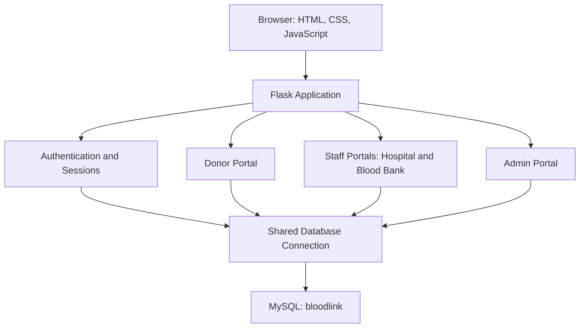
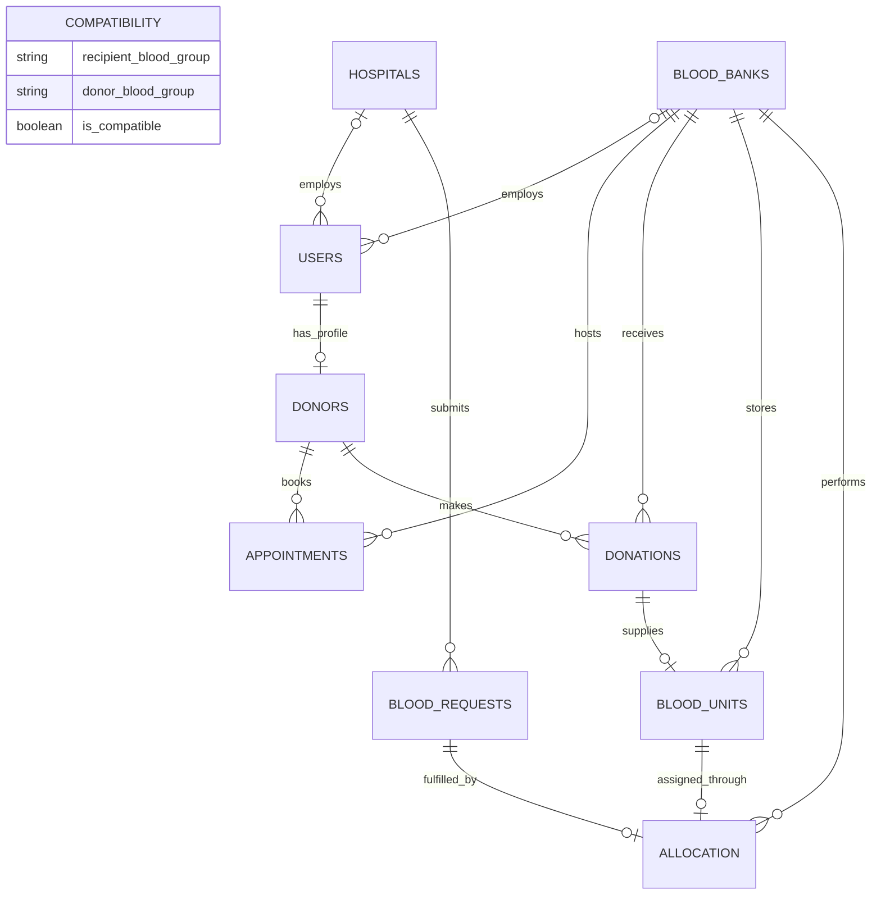
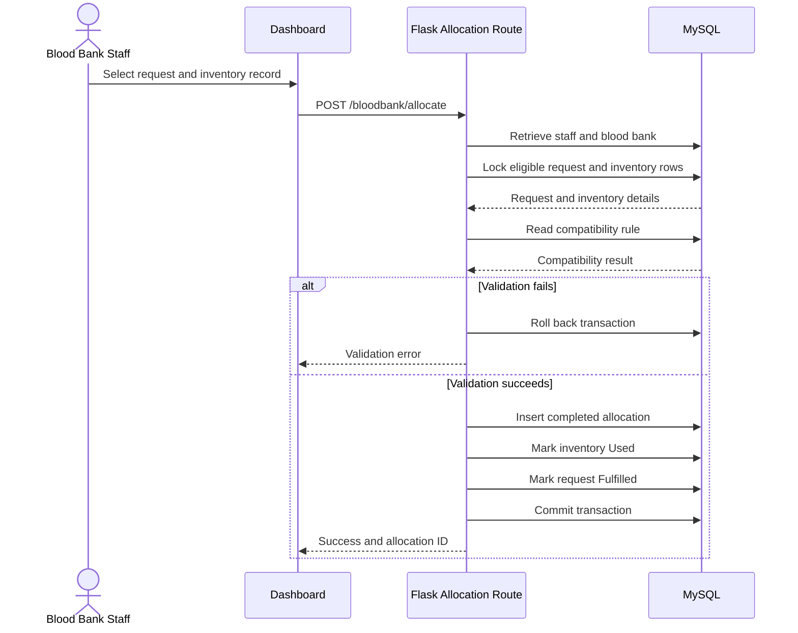

<div align="center">

# BloodLink
### Cloud-Native Distributed Blood Bank Management and Allocation System


</div>

## 1. Project Title and Team Members

**Project title:** Cloud-Native Distributed Blood Bank Management and Allocation System  
**Application name:** BloodLink  
**Institution:** Amrita Vishwa Vidyapeetham, Coimbatore  
**Department:** School of Artificial Intelligence  
**Programme:** B.Tech CSE (Artificial Intelligence)  
**Project group:** 13

| Team Member | Roll Number |
| --- | --- |
| Deeksha P | CB.SC.U4AIE24015 |
| Nila B | CB.SC.U4AIE24036 |
| Srinithi K | CB.SC.U4AIE24055 |
| Vani Shree S | CB.SC.U4AIE24059 |

The project title and team details follow the Group 13. The submitted implementation is a centralized Flask–MySQL application; cloud deployment and distributed operation are project directions rather than capabilities demonstrated by the supplied source.

## 2. Project Overview, Introduction, and Problem Statement

### Overview

BloodLink is a Flask and MySQL web application that connects donors, blood banks, hospitals, and administrators. It supports donor registration, appointment booking, inventory monitoring, hospital blood requests, and compatibility-based blood allocation.

### Introduction

Blood bank operations depend on consistent information about donors, donations, available stock, expiry dates, and hospital requirements. BloodLink stores these records in a relational database and provides dedicated dashboards for each user role. SQL joins and aggregation generate summaries, while transactions coordinate allocation updates.

### Problem Statement

Blood-bank information is often maintained across separate records and systems. Manually managing donors, blood banks, appointments, and donations can introduce inconsistencies and duplicate records. Finding donors by blood group, availability, and stored eligibility becomes difficult when these records are disconnected.

BloodLink addresses the need for a centralized relational database that connects these records and supports SQL-based searching, updating, reporting, inventory analysis, and allocation. The database also provides a foundation for future cloud deployment.

The project addresses this problem by providing a shared system to:

- Maintain donor, hospital, blood bank, and account records.
- Schedule donor appointments and display donation history.
- Track available stock and approaching expiry dates.
- Record hospital requirements with routine, urgent, or emergency priority.
- Validate compatibility before allocating inventory.
- Update request and inventory status together and preserve allocation history.

## 3. System Requirements and Architecture

### Software Requirements

| Component | Requirement |
| --- | --- |
| Operating system | Windows, macOS, or Linux |
| Python | Python 3.9 or later for the included Flask 3.1 dependency |
| Backend | Flask and Jinja2 |
| Database | MySQL with transactional tables; InnoDB is recommended |
| Database driver | MySQL Connector/Python |
| Frontend | HTML, CSS, JavaScript, Bootstrap 5 |
| Browser | A modern browser |
| Database setup | Matching schema, compatibility data, and initial accounts |

A standard development laptop capable of running Python, MySQL, and a browser is sufficient; hardware minimums have not been benchmarked. Internet access is needed to install dependencies and load externally hosted frontend assets.

### System Architecture

The implementation is one modular Flask application connected to one MySQL database. Its three logical layers are presentation, application logic, and data storage.



| Source | Responsibility |
| --- | --- |
| `app.py` | Creates the application and registers Blueprints |
| `config.py` | Supplies MySQL connections |
| `routes/auth.py` | Registration, login, and logout |
| `routes/donor.py` | Appointments, history, availability, and password changes |
| `routes/bloodbank.py` | Inventory and allocation |
| `routes/hospital.py` | Hospital requests and profile updates |
| `routes/admin.py` | User management and summary reporting |
| `templates/`, `static/` | Page templates, styling, and client-side scripts |

## 4. ER Diagram and UML Diagram

### ER Diagram

The Review 1 presentation identifies users, donors, blood banks, hospitals, appointments, donations, blood units, blood requests, allocations, and compatibility. The diagram below redraws their relationships to match the supplied application's queries. Compatibility is shown separately because the code implements it as a lookup table rather than the allocation-dependent weak entity in the original conceptual diagram.

The diagram shows the logical relationships implied by the application queries. The SQL DDL was not included in the source archive, so physical keys, uniqueness constraints, and exact cardinality enforcement must be verified against the actual database. Attributes are listed in Section 5.



The optional one-to-one links for donation-to-inventory and allocation describe the current application workflow. They are not a claim that the database enforces uniqueness. `compatibility` is a lookup relation keyed logically by recipient and donor blood groups; allocation checks it using group values, rather than a stored compatibility ID.

### UML Actor Responsibilities

The presentation's UML use-case model identifies four actors. The following mapping connects those actors to the supplied implementation:

| Actor | Implemented Interactions |
| --- | --- |
| Donor | Register/login, view stored eligibility, update availability, book appointments, view donation history |
| Blood Bank Staff | View appointments and donations, add inventory from completed donations, allocate blood |
| Hospital Staff | Submit blood requests, track request status, view allocations |
| Administrator | Create accounts, manage account status, view summaries and activity |

Donation-status updates and broader blood-availability search appear in the presentation's conceptual use cases; dedicated backend actions for these are not present in the supplied source. The UML sequence diagram below details the implemented allocation interaction.

### UML Sequence Diagram — Blood Allocation

This UML interaction diagram documents the implemented allocation transaction.



## 5. Relational Schema Mapping

### Review Design and Implementation Mapping

The slides provide a conceptual schema; the source uses the following physical names and associations. SQL examples in this README use the source-code names.

| Review Presentation | Supplied Application |
| --- | --- |
| `Users`, `Donors` | `users`, `donors` |
| `BloodBank(bank_id, bank_name, ...)` | `blood_banks` with `BankID`, `BankName`, `District`, and `BankType` referenced in code |
| `Hospital(hospitalID, ...)` | `hospitals` with `hospital_id` |
| Organisation linked to `user_id` | Staff linked through `users.hospital_id` or `users.blood_bank_id` |
| `Blood_Unit` directly linked to donor | `blood_units.donation_id` links to `donations`, which links to the donor |
| Patient-specific blood request attributes | Route stores group, quantity, dates, urgency, and hospital; patient fields are not used |
| Compatibility weak entity linked to allocation | `compatibility(recipient_blood_group, donor_blood_group, is_compatible)` lookup |
| Phone/status attributes marked as foreign keys | Source provides no evidence of referenced phone/status lookup tables; these are not asserted as foreign keys here |

### Relations Used by the Application

The following is the **code-derived logical schema**, listing attributes referenced by the application. It is not a complete database export. `PK` and `FK` indicate expected design roles; confirm physical constraints with `SHOW CREATE TABLE`.

```text
users(
  user_id PK, full_name, email, password, role, phone, status,
  created_at, hospital_id FK, blood_bank_id FK
)

donors(
  donor_id PK, user_id FK, blood_group, gender, date_of_birth,
  weight_kg, city, district, last_donation_date, availability, eligibility
)

blood_banks(BankID PK, BankName, District, BankType)

hospitals(hospital_id PK, hospital_name, district, phone)

appointments(
  appointment_id PK, donor_id FK, blood_bank_id FK,
  appointment_date, time_slot, status
)

donations(
  donation_id PK, donor_id FK, blood_bank_id FK,
  donation_date, units, status
)

blood_units(
  unit_id PK, blood_bank_id FK, donation_id FK, blood_group,
  collection_date, expiry_date, status, units
)

blood_requests(
  request_id PK, hospital_id FK, blood_group, units_required,
  request_date, required_date, urgency, status
)

compatibility(
  recipient_blood_group, donor_blood_group, is_compatible,
  proposed PK(recipient_blood_group, donor_blood_group)
)

allocation(
  allocation_id PK, request_id FK, unit_id FK,
  blood_bank_id FK, allocation_date, status
)
```

### Foreign-Key Mapping

| Referencing Attributes | Referenced Key |
| --- | --- |
| `donors.user_id` | `users.user_id` |
| `users.hospital_id`, `blood_requests.hospital_id` | `hospitals.hospital_id` |
| `users.blood_bank_id`, `appointments.blood_bank_id`, `donations.blood_bank_id`, `blood_units.blood_bank_id`, `allocation.blood_bank_id` | `blood_banks.BankID` |
| `appointments.donor_id`, `donations.donor_id` | `donors.donor_id` |
| `blood_units.donation_id` | `donations.donation_id` |
| `allocation.request_id` | `blood_requests.request_id` |
| `allocation.unit_id` | `blood_units.unit_id` |

Entities map to individual tables. One-to-many relationships map to references on the many side. `allocation` records the association between a request, inventory, and the performing blood bank, together with transaction details.

## 6. Normalization and Functional Dependencies

### Functional Dependencies

Assuming the identifier columns are unique, the following dependencies describe the logical design. “Remaining attributes” refers to the attributes listed in Section 5.

| Relation | Functional Dependency |
| --- | --- |
| `users` | `user_id → remaining attributes` |
| `donors` | `donor_id → remaining attributes` |
| `blood_banks` | `BankID → BankName, District, BankType` |
| `hospitals` | `hospital_id → hospital_name, district, phone` |
| `appointments` | `appointment_id → remaining attributes` |
| `donations` | `donation_id → remaining attributes` |
| `blood_units` | `unit_id → remaining attributes` |
| `blood_requests` | `request_id → remaining attributes` |
| `compatibility` | `(recipient_blood_group, donor_blood_group) → is_compatible` |
| `allocation` | `allocation_id → remaining attributes` |

Registration checks email uniqueness, and each donor account is intended to have one donor profile. Treat `email` and `donors.user_id` as alternate keys only if corresponding database uniqueness constraints exist.

The review presentation describes a design targeting 1NF, 2NF, and 3NF. The explanation below makes the conditions explicit and identifies where the actual DDL is needed to validate the claim.

### First Normal Form — 1NF

The application uses scalar values for names, dates, quantities, roles, and blood groups. Repeated appointments, donations, and requests are stored as separate rows. This is consistent with 1NF rather than storing lists of transactions within a user record.

### Second Normal Form — 2NF

For relations whose only candidate key is a single identifier, partial dependency on that key cannot occur. In `compatibility`, the compatibility result depends on the combination of donor and recipient groups. Under those key assumptions, these relations satisfy 2NF. Any additional composite candidate keys in the actual DDL must also be checked.

### Third Normal Form — 3NF

Separating user details, hospital details, and blood bank details avoids repeating organisation names and contact information in every appointment or request. This follows the principle of removing non-key dependencies from transaction relations.

However, a blanket claim that the complete implementation is in 3NF or BCNF is not supported by the supplied source:

- `blood_units` stores the donation date as `collection_date`, the donation quantity, and the blood bank alongside `donation_id`. If `donation_id` is not a candidate key, these dependencies can violate 3NF. If it is unique, they do not violate 3NF merely because they are duplicated across tables, but cross-table consistency still needs enforcement.
- `allocation` stores both `unit_id` and `blood_bank_id`, while an inventory record determines its blood bank. If `unit_id` is not a candidate key of `allocation`, the dependency `unit_id → blood_bank_id` introduces a non-key determinant.
- `last_donation_date` can duplicate information derivable from donation history and needs a consistent update rule.

A stricter design can derive the allocating bank from `unit_id`, avoid duplicating donation attributes unless they are intentional snapshots, and derive the last completed donation date. These are design improvements, not changes already implemented. Final normal-form certification requires the actual DDL and all business dependencies.

## 7. Methodology and Database Design

The following explains the design approach reflected in the source code.

1. **Requirement analysis:** Identify the four user roles and their information needs: donor scheduling, blood bank inventory, hospital demand, and administration.
2. **Entity identification:** Separate accounts, donor profiles, organisations, appointments, donations, inventory, requests, compatibility rules, and allocations.
3. **Relationship mapping:** Link transaction records using identifiers instead of repeating complete entity descriptions.
4. **Logical design:** Define the relations in Section 5 and examine dependencies as described in Section 6.
5. **Application integration:** Use Flask Blueprints for separate modules and a shared MySQL connection helper.
6. **Validation:** Check blood groups, quantities, account roles, organisation links, and allocation conditions in the backend.
7. **Transaction management:** Lock selected allocation rows, commit the three related writes together, and roll back on errors.
8. **Verification:** Check database connectivity, exercise each role, and compare database records before and after allocation.

### Database Rules Used by the Application

| Operation | Rule |
| --- | --- |
| Login | Account status must be `Active` |
| Appointment booking | Reject another active booking for the same donor, date, and time slot |
| Inventory creation | Use a completed donation from the staff member's bank without existing inventory |
| Inventory consistency | Group and quantity must match the selected donation |
| Inventory availability | Status is `Available` and expiry is today or later |
| Request selection | Request status is `Pending` or `Approved` |
| Allocation | Compatible blood groups and an exact quantity match with one inventory record |
| Successful allocation | Insert allocation, mark inventory `Used`, and mark request `Fulfilled` |

The review presentation reports ten implemented MySQL tables, imported synthetic data, primary/foreign keys, UNIQUE and CHECK constraints, and query testing. These are team-reported results; the archive does not include schema creation scripts, so the exact constraints, indexes, and storage engines must be confirmed against the database export. The code currently stores passwords directly, uses a fixed session secret, and enables debug mode; these are development limitations.

## 8. Advanced SQL Queries and Their Purpose

These queries reproduce or adapt SQL patterns present in the application. Named sample variables are for running examples in a MySQL client; application queries use parameter binding.

### 8.1 Multi-Table Join — Donation History

**Purpose:** Display donation records with donor names, blood groups, and blood bank names.

```sql
SELECT dn.donation_id, u.full_name, d.blood_group,
       b.BankName, dn.donation_date, dn.units, dn.status
FROM donations AS dn
JOIN donors AS d ON d.donor_id = dn.donor_id
JOIN users AS u ON u.user_id = d.user_id
LEFT JOIN blood_banks AS b ON b.BankID = dn.blood_bank_id
ORDER BY dn.donation_date DESC;
```

### 8.2 Conditional Aggregation — Inventory Summary

**Purpose:** Calculate usable stock and the quantity expiring within seven days for each bank and blood group.

```sql
SELECT blood_bank_id, blood_group,
       SUM(CASE
             WHEN status = 'Available' AND expiry_date >= CURDATE()
             THEN units ELSE 0
           END) AS available_units,
       SUM(CASE
             WHEN status = 'Available'
              AND expiry_date BETWEEN CURDATE()
                                  AND DATE_ADD(CURDATE(), INTERVAL 7 DAY)
             THEN units ELSE 0
           END) AS expiring_soon
FROM blood_units
GROUP BY blood_bank_id, blood_group;
```

This query returns groups with inventory records. The dashboard additionally constructs all eight groups to display zero-stock groups.

### 8.3 Correlated Subquery — Donations Eligible for Inventory

**Purpose:** Find completed donations that have not yet produced an inventory record.

```sql
SELECT d.donation_id, d.blood_bank_id, d.donation_date, d.units
FROM donations AS d
WHERE d.status = 'Completed'
  AND NOT EXISTS (
      SELECT 1
      FROM blood_units AS bu
      WHERE bu.donation_id = d.donation_id
  )
ORDER BY d.donation_date DESC;
```

### 8.4 CASE-Based Ordering — Prioritize Hospital Requests

**Purpose:** Display emergency requests before urgent and routine requests.

```sql
SELECT br.request_id, h.hospital_name, br.blood_group,
       br.units_required, br.urgency, br.status
FROM blood_requests AS br
JOIN hospitals AS h ON h.hospital_id = br.hospital_id
WHERE br.status IN ('Pending', 'Approved')
ORDER BY CASE br.urgency
           WHEN 'Emergency' THEN 1
           WHEN 'Urgent' THEN 2
           ELSE 3
         END,
         br.request_date DESC;
```

### 8.5 UNION ALL — Combined Activity Feed

**Purpose:** Merge registrations and hospital requests into one chronological activity list.

```sql
SELECT event_type, description, event_date
FROM (
    SELECT 'Registration' AS event_type,
           CONCAT(full_name, ' joined as ', role) AS description,
           created_at AS event_date
    FROM users
    UNION ALL
    SELECT 'Blood Request',
           CONCAT(request_id, ': ', units_required, ' units of ', blood_group),
           request_date
    FROM blood_requests
) AS events
ORDER BY event_date DESC
LIMIT 10;
```

### 8.6 Row Locking — Transactional Allocation

**Purpose:** Lock the chosen request and inventory record while validation and updates occur.

```sql
-- Replace these illustrative IDs with existing records.
SET @request_id = 'DEMO_REQUEST_ID';
SET @unit_id = 'DEMO_UNIT_ID';
SET @bank_id = 'DEMO_BANK_ID';

START TRANSACTION;

SELECT * FROM blood_requests
WHERE request_id = @request_id
  AND status IN ('Pending', 'Approved')
FOR UPDATE;

SELECT * FROM blood_units
WHERE unit_id = @unit_id
  AND blood_bank_id = @bank_id
  AND status = 'Available'
  AND expiry_date >= CURDATE()
FOR UPDATE;

-- Inspection example only: release locks without changing data.
ROLLBACK;
```

In the actual route, Python validates the locked rows and reads `compatibility`. On success, the same transaction inserts the allocation, updates inventory to `Used`, updates the request to `Fulfilled`, and commits. On validation failure or error, it rolls back. Run the actual allocation through the application so these checks are applied.

## 9. Installation, Setup, and Execution

### 9.1 Open the Project

Download or clone the repository and open a terminal in the directory containing `app.py`.

### 9.2 Create and Activate an Environment

```bash
python -m venv .venv
```

Windows Command Prompt:

```bat
.venv\Scripts\activate
```

macOS / Linux:

```bash
source .venv/bin/activate
```

### 9.3 Install Dependencies

```bash
python -m pip install -r requirements.txt
```

The supplied dependency file is UTF-16 encoded. If the installer reports an encoding error, save `requirements.txt` as UTF-8 and retry.

### 9.4 Import the Database

**Required external file:** a matching MySQL export containing schema and initial data. No such file is included in the supplied archive. Section 10 explains how the team can create it from its working database.

Once the team has added `database/bloodlink_demo.sql`, import it using MySQL Workbench or the MySQL client:

```bash
mysql -u root -p
```

At the MySQL prompt, use the actual absolute path:

```sql
SOURCE C:/path/to/BloodLink/database/bloodlink_demo.sql;
```

On macOS/Linux, use the corresponding `/path/to/...` form. The export command in Section 10 includes database creation and selection statements.

### 9.5 Configure the Connection

Edit the constants in `config.py`:

```python
DB_HOST = "127.0.0.1"
DB_PORT = 3306
DB_USER = "your_mysql_user"
DB_PASSWORD = "your_mysql_password"
DB_NAME = "bloodlink"
```

The application reads these constants directly; automatic `.env` loading is not implemented.

### 9.6 Check and Start

```bash
python test_db.py
python app.py
```

The first command checks connectivity and prints the user count. The second starts the Flask development server. Open **http://127.0.0.1:5000**.

## 10. Demonstration and Database-State Reproduction

### 10.1 Prepare a Reproducible Baseline

Use the finalized synthetic dataset described in the review presentation to prepare the working demonstration database. The uploaded source alone cannot reproduce the original database state because it contains neither the DDL nor the data.

Prepare these records in the matching database:

| Record | Required State |
| --- | --- |
| Administrator | Active account with role `Admin` |
| Donor | Active `Donor` account and linked donor profile |
| Hospital | Existing hospital with an active linked `HospitalStaff` account |
| Blood bank | Existing blood bank with an active linked `BloodBankStaff` account |
| Donation | Completed donation at that blood bank, with no existing inventory record |
| Compatibility | An enabled rule for the donor and recipient groups used in the demo |

Use fictional account details and choose demo-only passwords when preparing these accounts. Retrieve the baseline account emails and roles with:

```sql
SELECT full_name, email, role, status, hospital_id, blood_bank_id
FROM users
WHERE status = 'Active'
ORDER BY role, full_name;
```

Provide the chosen synthetic demo credentials to the evaluator with the baseline dataset. No account credentials are assumed in this README.

The current application does not implement a donation-completion action. The completed donation must therefore be supplied in the baseline database.

### 10.2 Export the Baseline

Create a `database` folder in the repository. With demonstration writes paused, run this command from the repository root, replacing `root` if needed:

```bash
mysqldump -u root -p --single-transaction --routines --triggers --events --add-drop-table --databases bloodlink --result-file=database/bloodlink_demo.sql
```

This creates the **missing deliverable**; it is not a file already present in the uploaded project. The selected options include schema, data, database selection, and stored objects. Required export privileges depend on the database configuration. `--single-transaction` provides a consistent snapshot for transactional tables such as InnoDB.

Commit this synthetic baseline export alongside the README. Record the MySQL version using `SELECT VERSION();` so another evaluator can use a compatible environment.

### 10.3 Restore Before Each Demonstration

Use a dedicated local demonstration database instance and import the saved baseline through `SOURCE` as shown in Section 9. The dump contains table-drop statements and replaces the baseline tables' current contents; do not import it over a database whose data must be retained.

For an exact clean baseline, use a fresh MySQL instance or an empty dedicated `bloodlink` database. Importing into a database with additional unrelated tables does not remove those extra tables.

Verify the starting state:

```sql
USE bloodlink;
SHOW TABLES;
SELECT COUNT(*) AS users_count FROM users;
SELECT COUNT(*) AS donations_count FROM donations;
SELECT COUNT(*) AS inventory_count FROM blood_units;
SELECT COUNT(*) AS requests_count FROM blood_requests;
SELECT COUNT(*) AS allocations_count FROM allocation;
SELECT role, status, COUNT(*) AS accounts
FROM users
GROUP BY role, status;
```

Record these counts when creating the baseline and compare them after restoration. For physical schema verification, run `SHOW CREATE TABLE table_name;` for each table.

### 10.4 Run the Demonstration

| Step | Action | Expected Result |
| --- | --- | --- |
| 1 | Start MySQL, run `python test_db.py`, then `python app.py` | Connection succeeds and the home page opens |
| 2 | Log in as Admin | System statistics and account records are displayed |
| 3 | Log out; log in as Donor and book a future appointment | A scheduled appointment appears in appointment history |
| 4 | Log out; log in as Blood Bank staff and select the baseline completed donation | Eligible donation is available for inventory creation |
| 5 | Add inventory with matching group and quantity and a future expiry date | A new `Available` inventory record is created |
| 6 | Log out; log in as Hospital staff and request a compatible group with exactly that quantity | A `Pending` request is created |
| 7 | Log out; log in as Blood Bank staff and allocate the new inventory to that request | Allocation succeeds |
| 8 | Log in as Hospital staff and review requests and allocations | Request is `Fulfilled` and allocation is visible |

Log out between roles, or use separate browser profiles, to avoid sharing one session across demonstration accounts.

### 10.5 Verify the Result and Repeat

Run the following query and inspect the newly created request and inventory identifiers:

```sql
SELECT a.allocation_id, a.request_id, a.unit_id,
       a.status AS allocation_status,
       br.status AS request_status,
       bu.status AS inventory_status,
       br.units_required, bu.units
FROM allocation AS a
JOIN blood_requests AS br ON br.request_id = a.request_id
JOIN blood_units AS bu ON bu.unit_id = a.unit_id
ORDER BY a.allocation_date DESC, a.allocation_id;
```

For the demonstrated transaction, expect `Completed`, `Fulfilled`, and `Used`, with equal requested and allocated quantities. There should be one additional allocation relative to the baseline if the steps were performed once.

Restore the baseline export before repeating. UUID-generated identifiers and date-dependent dashboard values can differ between runs; restoration reproduces the saved starting data, while the walkthrough reproduces the same logical state changes. Ensure demonstration expiry dates remain in the future when preparing a new baseline.
